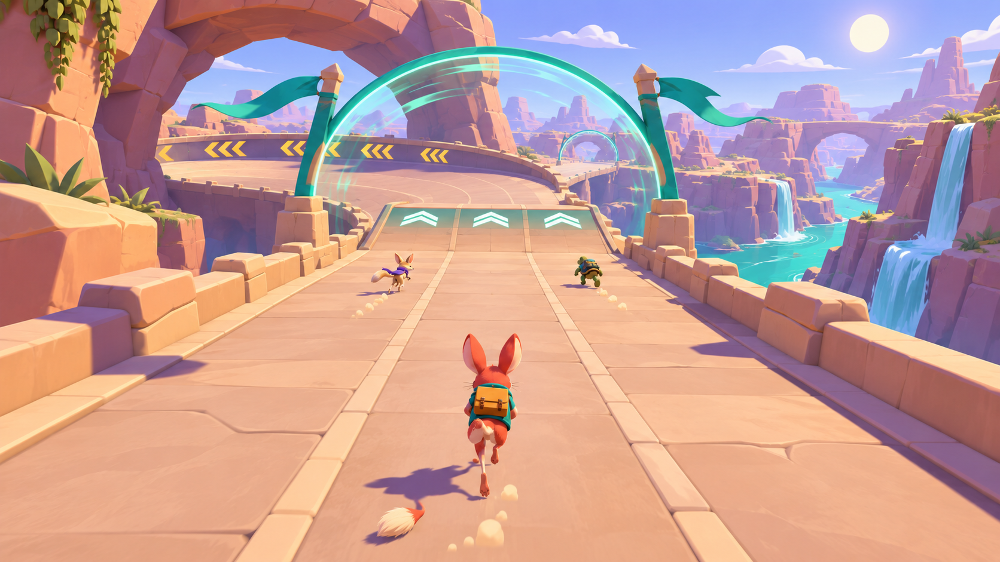

# Ridge Relay

Ridge Relay is a 3D footrace prototype for Unity. Race through Windmill Gorge from a behind-the-runner camera, switch lanes to avoid obstacles, jump gaps, and use gadgets to gain an edge.

*Concept art for the chase-camera view.*

## What’s in the project

- Windmill Gorge features a hill crest, a downhill jump shortcut, and a split tunnel with a faster right-hand route.
- Keyboard and touch controls, mirrored touch buttons, and a reduced-motion setting.
- Four gadgets, checkpoint recovery, race results, and a locally saved best time.
- Editable Blender sources for the rigged courier, environment and pickups.
- Private races with join codes using Unity Multiplayer Services, Relay and Netcode for GameObjects. A linked Unity Cloud project is required for online play.

## Run in Unity

1. In Unity Hub, add the repository folder and open it with **Unity 6000.6.10f1**. Allow the initial asset and package import to finish.
2. Choose **Ridge Relay → Prepare Project**.
3. Open `Assets/RidgeRelay/Race.unity` and press **Play**. Select **Play** on the title screen to race offline.

| Action | Keyboard | Touch |
| --- | --- | --- |
| Change lanes | A / D or ← / → | Swipe left or right |
| Jump | ↑ or Space | Swipe up |
| Use gadget | E | Tap the gadget button |
| Pause | Esc | Tap Pause |

## Race tactics

- **Slipstream** builds while you follow close behind a rival in the same lane. Fill the meter for a short speed burst.
- **Tailwind** gives an immediate burst. **Pulse Shot** warns a rival ahead in your lane before slowing them. Change lanes, jump, or use **Shell Film** to defend. **Bristle Pad** leaves a hazard for the runners behind you.
- Pickup gates award one gadget per racer. The first gate teaches Tailwind. Later gates give trailing racers better odds of drawing Tailwind or Pulse Shot.
- Look for gold markings on the downhill shortcut and commit to a tunnel route before the divider. The narrower right passage is faster, and poor timing can still cost the advantage.

## Build and test

- **Windows** — Choose **Ridge Relay → Build Windows**. The output is `Builds/Windows/Ridge Relay.exe`.
- **Android** — Add Android Build Support, SDK & NDK Tools, and OpenJDK for this editor version in Unity Hub. Choose **Ridge Relay → Build Android APK** for a local test APK, or use **Build and Run** with a USB-connected Android device.
- **Editor smoke test** — Choose **Ridge Relay → Run Play Mode Smoke Check**. It exercises the title menu, keyboard and simulated touch input, the camera, gadgets, results, and retry.

The Windows build, Android APK, and live Relay sessions still need runtime verification.

## Private races

Link the project to a Unity Cloud project and configure Authentication and Multiplayer Services. Choose **Private Race** to host or join with a code. Rooms support up to four people, with bots filling open slots. For same-PC testing, launch each Windows player instance with a different profile, such as `-ridgeRelayProfile host` and `-ridgeRelayProfile guest`. [Unity Multiplayer Services setup](https://docs.unity.com/en-us/mps-sdk/get-started)

## Project files

| Directory | Contents |
| --- | --- |
| [Assets/RidgeRelay](Assets/RidgeRelay) | Race scene, gameplay, UI, networking, and Unity editor tools |
| [ArtSource](ArtSource) | Editable Blender files and export scripts |
| [Design](Design) | Game design, technical plan, and concept art |
